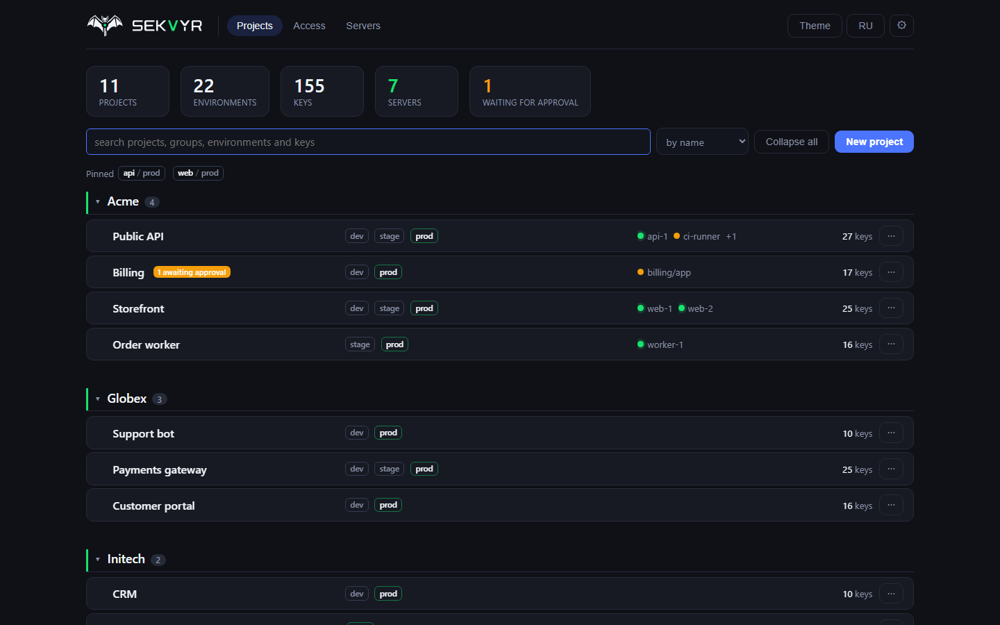
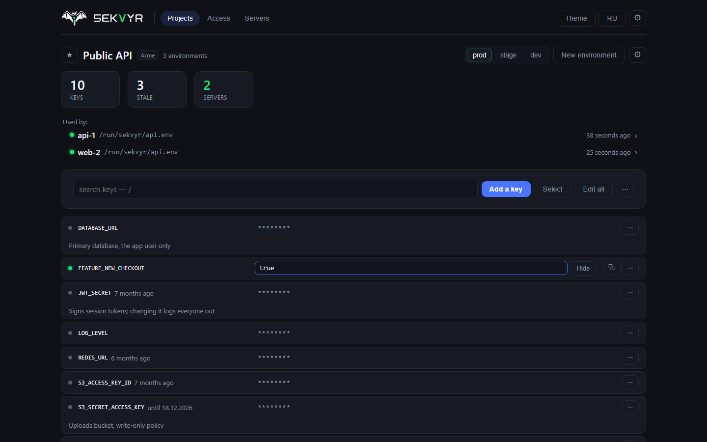
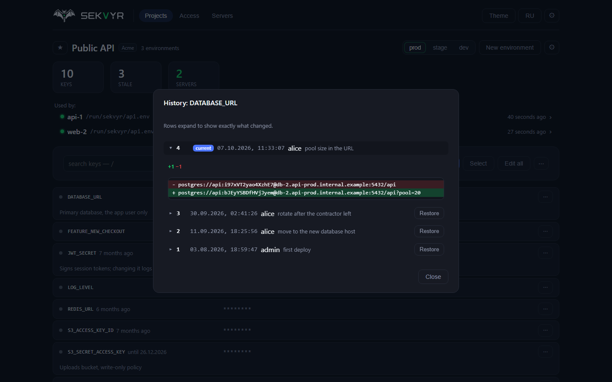
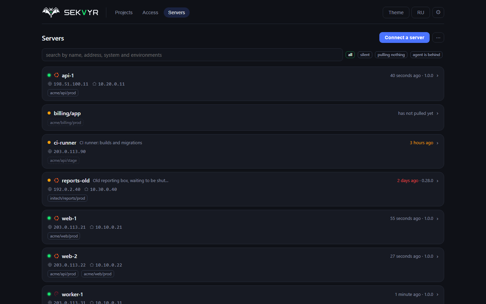
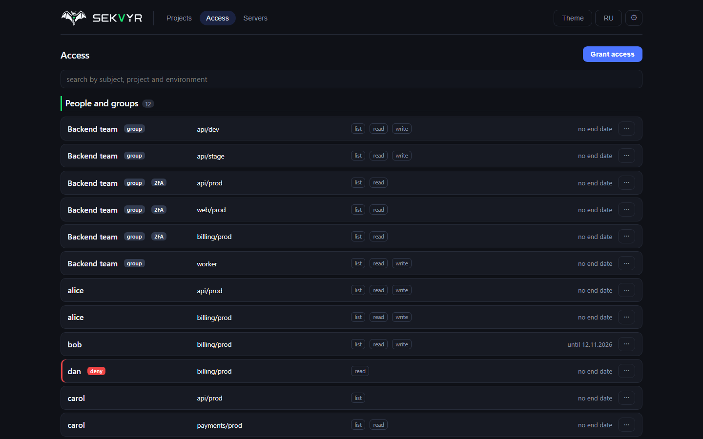

# Sekvyr

A self-hosted panel for secrets and environment variables. People edit values in
the web UI; servers and clusters pull them over the API and keep their local
`.env` files in sync, so a change reaches the service on its own. The admin UI
sits behind an allow-list or a VPN, the machine API is public: two separate
surfaces, not one with caveats.

[Русская версия](README.ru.md) | [sekvyr.ru](https://sekvyr.ru) | [Install guide](docs/install.md) | [Security](SECURITY.md) | [Changelog](CHANGELOG.md)

```bash
curl -fsSL https://raw.githubusercontent.com/mihsergeev/Sekvyr/main/ops/quickstart.sh | sudo sh
```

That command installs Docker if needed, brings up Caddy with a real Let's
Encrypt certificate, starts the panel with nightly encrypted backups and a
watchdog, and prints the address and the owner password. No domain of your own
is required: `<server-ip>.sslip.io` works out of the box. For a permanent
installation pass your domain and the addresses allowed into the admin UI:
`... | sudo sh -s -- --domain sekvyr.example.com --allow-ips "203.0.113.10"`.



<table>
<tr>
<td width="50%"><a href="docs/img/environment.png"></a><br><sub>An environment: keys, notes, replacement dates, who reads it</sub></td>
<td width="50%"><a href="docs/img/history.png"></a><br><sub>Versions of a key: who, when, what it was before, one-click rollback</sub></td>
</tr>
<tr>
<td width="50%"><a href="docs/img/servers.png"></a><br><sub>Servers: what each one pulls, agent versions, who went silent</sub></td>
<td width="50%"><a href="docs/img/access.png"></a><br><sub>Access: who may list, read or write what, and until when</sub></td>
</tr>
</table>

<sub>The screenshots are taken from a running panel on demo data, with the same
frontend that ships in the image. Every project, host and address in them is
invented (RFC 2606 / RFC 5737). See <a href="docs/make-shots.py">docs/make-shots.py</a>.</sub>

---

## What it does

**Secrets per project and environment.** A project holds environments (dev,
stage, prod), which hold folders and keys. `.env` import and export, inherited
values, search. Navigation is built for hundreds of projects.

**Versions and rollback.** Values are never overwritten: every edit is a new
version. You can see what a key held yesterday, diff two versions, and diff a
whole environment across a week. A rollback creates a new version with the old
value; a deletion is a version too, and is therefore reversible.

**Permissions enforced by the API.** A subject, a scope (project, environment,
folder) and actions, with `list` and `read` kept apart, so a developer can see
which variables an app needs without seeing production passwords. The check
lives in one place on the way in, not in each handler.

**Approval by role.** Whoever runs the project edits directly. An edit from a
role below the project's threshold waits for approval from a higher role: it is
visible in the history but does not become current and does not reach servers.

**One command to connect a server.** The panel hands you a line with a one-time
token; the agent installs itself on the node, receives its own machine secret
and shows up in the list. Access is then granted by pointing and clicking, and
revoked with one button. A change in the panel reaches the service by itself.

**Servers only read.** A connected machine cannot change or delete a secret:
none of the four machine routes that change anything touches values, and CI
checks that it stays that way.

**Clusters without static secrets.** A pod presents its own ServiceAccount token
and the panel verifies the signature against the cluster keys. For those who
already run External Secrets Operator, that path works too.

**Operations.** Encrypted backups with a freshness check, one-command restore,
emergency access to values without the panel, Telegram and webhook alerts, a
copy of the audit log on an external receiver, and a watchdog outside the
containers.

**Migration from Infisical and Vault.** A separate screen with a preview: you see
what arrives new and what is already there, and existing values are not
overwritten by default.

**Browser-side encryption.** For selected projects: values are encrypted with a
key the server does not have at all. The price is honest: a forgotten project
password means losing the values.

**Finding your way.** One field on Ctrl+K searches projects, environments,
servers and keys and takes you there. Pinned environments live on the home
page, and every list has its own search: projects, servers, grants, audit log,
keys. With a couple of hundred projects the walk to the right place is the main
cost, and the panel is built around that.

**A list you can keep in order.** Groups collapse, favourite projects rise to
the top, other teams' projects can be put out of sight, and inside a group
projects are ordered by name, by last change or by key count. That layout
belongs to one browser; your neighbour has their own. A closed project goes to
the archive: it leaves the list and the totals for everyone, while its keys and
audit trail stay, and it can be restored at any time.

**Custom logo.** The owner puts the company logo into the header and onto the
sign-in screen. The panel adapts it to both themes on its own: a hard-to-read
wordmark is recoloured towards the panel's text colour, brand colours only get
as much lightness as they need to be readable, and an image with its own
background goes onto a plate. Both themes are previewed before saving.

**Telling environments apart.** Comparing two environments answers where values
differ and what is missing, without showing the values themselves. "Find
matching values" finds every place holding the same password, the question
asked when one leaks. A list of keys nobody has opened in a year shows where to
start cleaning up.

**Spreading values.** One token can be written into several environments at
once, a rename can follow every environment of the project, and a new
environment can be created as a copy of an existing one. Required keys of a
project show up as what is missing in each environment, including a fresh one.

**Value hygiene.** A key carries a note saying what it is for and a date by
which the value must be replaced; the panel reminds in advance. The age of stale
values is visible in the row, and the threshold is set per project. Notes on
values (`changeme` in production, debug on a live stand) are found by the panel
itself, and new ones are reported.

**Watching the fleet.** Each server shows its system, country and both
addresses; an agent behind the served version is highlighted, and the panel
reports a machine that has not pulled secrets for a day. Once a week a digest of
changes is sent.

## Security

- **Three key levels.** A value is encrypted with its environment key, which is
  wrapped by the root key. Ciphertext is bound to its location, so a row cannot
  be moved to another environment or swapped with someone else's value.
- **The panel starts sealed.** Without the root key nothing is readable by
  anyone, the owner included. The key is kept as shares (3 of 5 by default), as
  one key you enter after each restart, or as a file on the server: chosen when
  the vault is created. The file can also be added later, in any mode, shares
  included: the "Remember the key on the server" button in the Vault section
  (it appears once `SEKVYR_ROOT_KEY_FILE` is set).
- **No plaintext in the database.** A database dump, and its backup, are noise
  without the key.
- **Hash-chained audit log.** Every entry carries the hash of the previous one,
  so a row cannot be removed or edited unnoticed, and the panel recounts the
  chain daily. A copy of the entries goes to an external receiver, otherwise the
  log could be trimmed together with the database. Secret values never enter
  the log.
- **The panel does not run as root.** The backend container starts as root only
  to fix the owner of the data volume and drops to uid 10001 through gosu right
  away; the frontend is unprivileged nginx on port 8080. The panel containers
  (database, backend, frontend) have `no-new-privileges`. caddy-docker-proxy,
  which quickstart starts, is a separate container: it runs as root with the
  Docker socket mounted.
- **The panel refuses to start** with a weak token-signing secret or a default
  password.

What is protected and what is not: [security model](docs/security-model.md) |
[threat model](docs/threat-model.md).

## Requirements

- A Linux server with Docker and Compose 2.24 or newer.
- An HTTPS reverse proxy in front, or `compose.caddy.yml` with
  caddy-docker-proxy as quickstart sets it up. Do not publish the panel without
  HTTPS.
- No external services: everything lives in your own Postgres.

## Running it

The command at the top takes the released images. With `--build` it builds them
from source instead (a few minutes and about 2 GB of RAM), and it does so by
itself on servers other than amd64; `--dir` changes the install directory,
`/opt/sekvyr` by default. Running the command again updates the panel, with
the same `--dir` if one was given.

By hand, behind your own HTTPS proxy:

```sh
git clone https://github.com/mihsergeev/Sekvyr.git /opt/sekvyr && cd /opt/sekvyr
cp .env.example .env && chmod 600 .env
# set SEKVYR_ADMIN_PASSWORD, SEKVYR_JWT_SECRET (openssl rand -hex 32),
# SEKVYR_DB_PASSWORD and SEKVYR_PANEL_URL; SEKVYR_TRUSTED_PROXY_HOPS=2,
# since your proxy stands in front of the frontend nginx
docker compose up -d --build
```

The panel comes up on `127.0.0.1:8080`. Behind caddy-docker-proxy, with the
released images and the rest of the details: [installing and running](docs/install.md).

## Documentation

[Installing and running](docs/install.md) |
[backups and emergency access](docs/backup.md) |
[a Docker app](docs/app-docker.md) |
[Kubernetes](deploy/kubernetes/README.md) |
[migrating from Infisical and Vault](docs/migrate.md) |
[browser-side encryption](docs/e2e.md) |
[security model](docs/security-model.md) |
[threat model](docs/threat-model.md)

## Development

```sh
cd backend && python -m venv .venv && .venv/bin/pip install -e ".[dev]"
.venv/bin/pytest -q                                   # backend tests
export SEKVYR_DEBUG=1 SEKVYR_ADMIN_PASSWORD=dev-password-1
.venv/bin/alembic upgrade head && .venv/bin/uvicorn app.main:app --reload --port 8000

cd ../frontend && npm ci
npm run dev                                           # http://localhost:5173, /api goes to :8000
npm test                                              # frontend tests

cd .. && backend/.venv/bin/python ops/selfcheck.py    # drift between frontend, backend and docs
```

`ops/selfcheck.py` needs the `cryptography` package, so run it with the Python
from `backend/.venv`.

`SEKVYR_DEBUG=1` lifts the refusal to start with weak secrets and serves the API
schema at `/api/docs`; never set it on a real installation.

## License

[AGPL-3.0](LICENSE).
