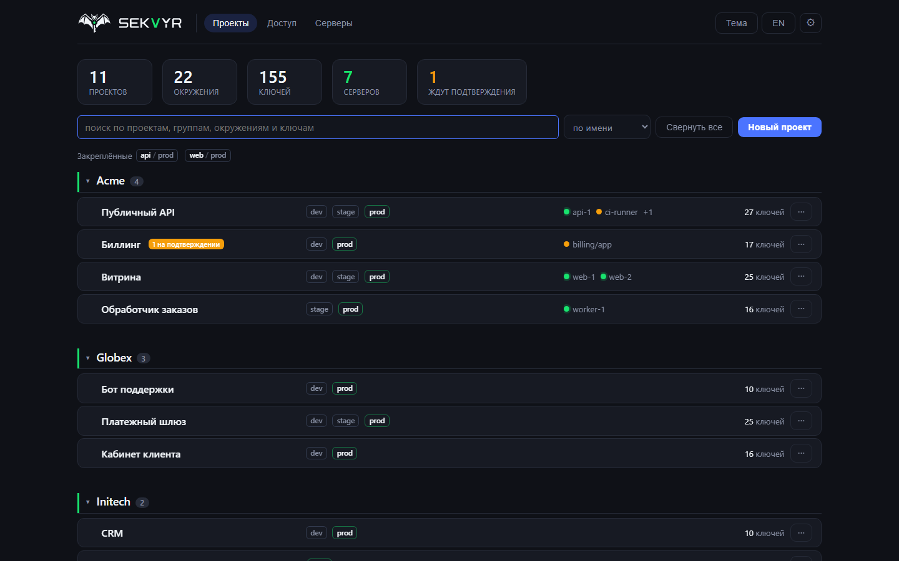
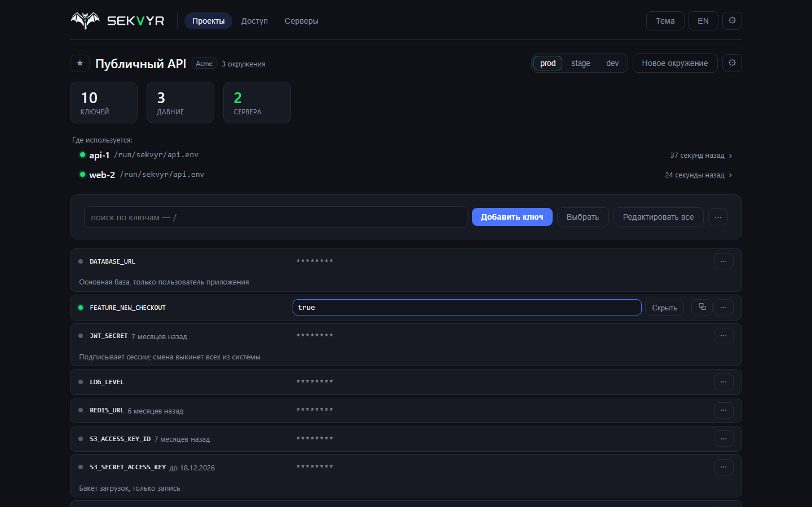
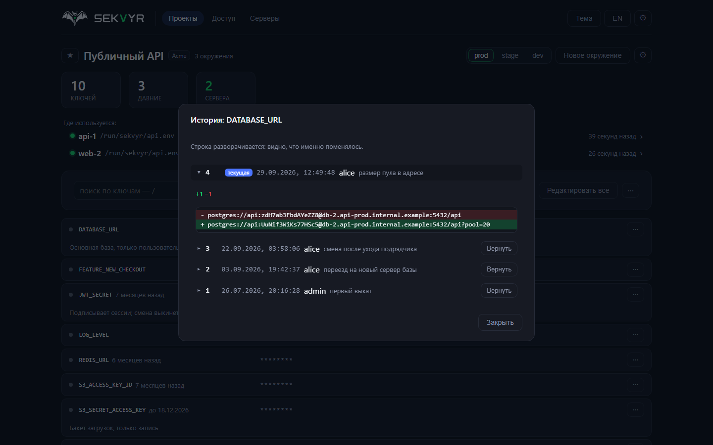
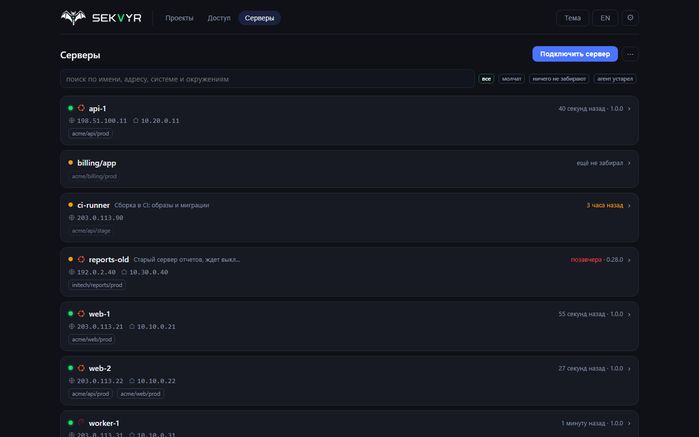
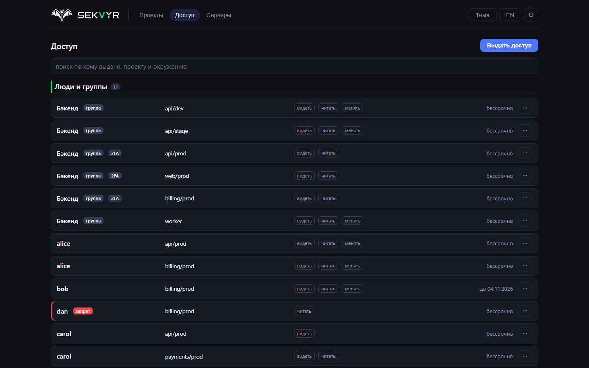

# Sekvyr

Панель хранения секретов и переменных окружения на своем сервере. Люди правят
значения в вебе, серверы и кластеры забирают их по API и держат свои `.env` в
актуальном состоянии, поэтому изменение в панели доезжает до сервиса само.
Админка живет за белым списком адресов или VPN, машинный контур открыт наружу:
это два разных контура, а не один с оговорками.

[English version](README.md) | [sekvyr.ru](https://sekvyr.ru) | [Установка](docs/install.ru.md) | [Безопасность](docs/security-model.ru.md) | [Changelog](CHANGELOG.md)

```bash
curl -fsSL https://raw.githubusercontent.com/mihsergeev/Sekvyr/main/ops/quickstart-ru.sh | sudo sh
```

Команда ставит Docker, если его нет, поднимает Caddy с настоящим сертификатом
Let's Encrypt, запускает панель с ночными шифрованными бэкапами и сторожем и
печатает адрес и пароль владельца. Свой домен не нужен: `<ip-сервера>.sslip.io`
работает сразу. Для постоянной установки передайте свой домен и адреса, которым
открыта админка:
`... | sudo sh -s -- --domain sekvyr.example.ru --allow-ips "203.0.113.10"`.



<table>
<tr>
<td width="50%"><a href="docs/img/ru/environment.png"></a><br><sub>Окружение: ключи, подписи, сроки замены, кто его читает</sub></td>
<td width="50%"><a href="docs/img/ru/history.png"></a><br><sub>Версии ключа: кто, когда, что было раньше, откат одной кнопкой</sub></td>
</tr>
<tr>
<td width="50%"><a href="docs/img/ru/servers.png"></a><br><sub>Серверы: что забирает каждый, версии агентов, кто замолчал</sub></td>
<td width="50%"><a href="docs/img/ru/access.png"></a><br><sub>Доступ: кому что можно видеть, читать и менять и до какого числа</sub></td>
</tr>
</table>

<sub>Кадры сняты с работающей панели на демо-данных, с тем же фронтендом, что
лежит в образе. Все проекты, хосты и адреса на них выдуманы (RFC 2606 / RFC 5737).
См. <a href="docs/make-shots.py">docs/make-shots.py</a>.</sub>

---

## Что умеет

**Секреты по проектам и окружениям.** Проект, внутри окружения (dev, stage,
prod), внутри папки и ключи. Импорт и экспорт `.env`, наследование значений,
поиск. Навигация рассчитана на сотни проектов.

**Версии и откат.** Значение не перезаписывается: каждая правка - новая
версия. Видно, каким ключ был вчера, чем отличаются две версии и что поменялось
в окружении за неделю. Откат создает новую версию с прежним значением, удаление
тоже версия и потому обратимо.

**Права, которые проверяет API.** Кому, где (проект, окружение, папка) и что
можно, причем `list` и `read` разделены: разработчик видит, какие переменные
нужны приложению, не видя прод-паролей. Проверка живет в одной точке на входе, а
не в каждом обработчике.

**Согласование по ролям.** Кто в проекте главный, тот правит сразу. Правка от
роли ниже порога ждет подтверждения роли выше: она видна в истории, но текущей
не становится и на серверы не уезжает.

**Подключение сервера одной командой.** Панель выдает строку с одноразовым
токеном, агент ставится на ноду, получает свой секрет машины и появляется в
списке. Дальше доступ выдается мышью, отзывается одной кнопкой. Изменение в
панели доезжает до сервиса само.

**Сервер только читает.** Подключенная машина не может изменить или удалить
секрет: из четырех машинных маршрутов, которые что-то меняют, ни один не
касается значений, и это проверяется в CI.

**Кластеры без статических секретов.** Под предъявляет свой ServiceAccount-токен,
панель проверяет подпись по ключам кластера. Для тех, у кого уже стоит External
Secrets Operator, работает и он.

**Эксплуатация.** Шифрованные бэкапы с проверкой свежести, восстановление одной
командой, аварийный доступ к значениям без панели, оповещения в Telegram и
вебхуки, копия журнала на внешнем приемнике, сторож вне контейнеров.

**Переезд с Infisical и Vault.** Отдельный экран с предпросмотром: видно, что
приедет нового и что уже есть, а существующее по умолчанию не переписывается.

**Шифрование в браузере.** Для отдельных проектов: значения шифруются ключом,
которого у сервера нет вовсе. Плата честная: забытый пароль проекта означает
потерю значений.

**Поиск и дорога до места.** Одно поле по Ctrl+K ищет проекты, окружения,
серверы и ключи и ведет туда. Закладки на рабочие стенды живут на главной,
поиск есть в каждом списке: проекты, серверы, права, журнал, ключи. При двух
сотнях проектов дорога до места - основная трата времени, и панель сделана
вокруг этого.

**Список, которым можно управлять.** Группы сворачиваются, избранные проекты
поднимаются наверх, чужие убираются с глаз, порядок внутри группы - по имени, по
свежести правок или по числу ключей. Все это раскладка одного браузера, у соседа
своя. Закрытый проект уходит в архив: он пропадает из списка и из сводки у всех,
но ключи и журнал остаются, и вернуть его можно в любой момент.

**Свой логотип.** Владелец ставит в шапку и на экран входа логотип компании.
Панель сама подстраивает его под обе темы: плохо читаемую надпись перекрашивает
в тон тексту панели, фирменным цветам меняет только светлоту и ровно до
читаемости, картинку со своим фоном кладет на плашку. Результат видно на обеих
темах до сохранения.

**Разбор расхождений.** Сравнение двух окружений отвечает, где значения разные
и чего не хватает, не показывая самих значений. "Найти совпадения значения"
показывает все места с тем же паролем: вопрос, который задают при компрометации.
Список ключей, которых за год никто не открывал, подсказывает, с чего начинать
чистку.

**Раскладка по стендам.** Один токен записывается сразу в несколько окружений,
переименование ключа проходит по всем стендам проекта, новое окружение
заводится копией существующего. Обязательные ключи проекта видны нехваткой в
каждом окружении, включая только что созданное.

**Гигиена значений.** У ключа есть подпись "зачем он нужен" и дата, к которой
значение надо заменить: панель напоминает заранее. Возраст давних значений
виден в строке, порог задается в проекте. Замечания к значениям (`changeme` в
проде, отладка на боевом стенде) панель находит сама и сообщает о новых.

**Присмотр за парком.** Видно систему, страну и оба адреса каждого сервера и
устаревшую версию агента, а о машине, которая сутки не забирает секреты, панель
сообщает сама. Раз в неделю уходит сводка правок.

## Безопасность

- **Три уровня ключей.** Значение шифруется ключом окружения, ключ окружения -
  корневым ключом. Шифротекст привязан к своему месту, поэтому строку в базе
  нельзя переставить в другое окружение или подменить чужим значением.
- **Запертая панель.** Пока корневой ключ не введен, значения не читаются
  никем, включая владельца. Ключ хранится долями (по умолчанию 3 из 5), одним
  ключом, который вы вводите после каждого перезапуска, или файлом на сервере:
  способ выбирается при заведении сейфа. Файл можно добавить и позже, в любом
  режиме, включая доли: кнопка "Запомнить ключ на сервере" в разделе "Сейф"
  (она появляется, когда задан `SEKVYR_ROOT_KEY_FILE`).
- **В базе нет открытых значений.** Дамп базы и ее бэкап без ключа остаются
  шумом.
- **Журнал с хеш-цепочкой.** Каждая запись хранит хеш предыдущей: вырезать или
  подправить строку в середине незаметно нельзя, и панель пересчитывает цепочку
  раз в сутки. Копия записей уезжает на внешний приемник, иначе журнал можно
  срезать вместе с базой. Значения секретов в журнал не попадают никогда.
- **Панель не работает от root.** Контейнер бэкенда стартует от root только
  чтобы выровнять владельца тома с данными и сразу сбрасывает права до uid 10001
  через gosu, фронтенд - непривилегированный nginx на порту 8080. У контейнеров
  панели (база, бэкенд, фронтенд) `no-new-privileges`. caddy-docker-proxy,
  который поднимает quickstart, - отдельный контейнер: он работает от root, и к
  нему подключен сокет Docker.
- **Панель не стартует** со слабым секретом подписи токенов и с паролем по
  умолчанию.

Что защищено и что нет: [модель безопасности](docs/security-model.ru.md) |
[модель угроз](docs/threat-model.ru.md).

## Что нужно

- Сервер с Linux, Docker и Compose 2.24 или новее.
- Обратный прокси с HTTPS впереди или `compose.caddy.yml` с caddy-docker-proxy,
  как ставит quickstart. Без HTTPS панель наружу не публикуйте.
- Никаких внешних сервисов: все лежит в вашем Postgres.

## Запуск

Команда наверху берет выпущенные образы. С `--build` она собирает их из
исходников (несколько минут и около 2 ГБ памяти), а на серверах не amd64
делает так сама. `--dir` меняет каталог установки, по умолчанию `/opt/sekvyr`.

Вручную, за своим HTTPS-прокси:

```sh
git clone https://github.com/mihsergeev/Sekvyr.git /opt/sekvyr && cd /opt/sekvyr
cp .env.example .env && chmod 600 .env
# задайте SEKVYR_ADMIN_PASSWORD, SEKVYR_JWT_SECRET (openssl rand -hex 32),
# SEKVYR_DB_PASSWORD и SEKVYR_PANEL_URL; SEKVYR_TRUSTED_PROXY_HOPS=2, потому
# что ваш прокси стоит перед nginx фронтенда
docker compose up -d --build
```

Панель поднимется на `127.0.0.1:8080`. За caddy-docker-proxy, на выпущенных
образах и остальные подробности: [установка и эксплуатация](docs/install.ru.md).

## Документация

[Установка и эксплуатация](docs/install.ru.md) |
[бэкапы и аварийный доступ](docs/backup.ru.md) |
[приложение в Docker](docs/app-docker.ru.md) |
[Kubernetes](deploy/kubernetes/README.ru.md) |
[переезд с Infisical и Vault](docs/migrate.ru.md) |
[шифрование в браузере](docs/e2e.ru.md) |
[модель безопасности](docs/security-model.ru.md) |
[модель угроз](docs/threat-model.ru.md)

## Разработка

```sh
cd backend && python -m venv .venv && .venv/bin/pip install -e ".[dev]"
.venv/bin/pytest -q                                   # тесты бэкенда
export SEKVYR_DEBUG=1 SEKVYR_ADMIN_PASSWORD=dev-password-1
.venv/bin/alembic upgrade head && .venv/bin/uvicorn app.main:app --reload --port 8000

cd ../frontend && npm ci
npm run dev                                           # http://localhost:5173, /api уходит на :8000
npm test                                              # тесты интерфейса

cd .. && backend/.venv/bin/python ops/selfcheck.py    # расхождения между фронтом, бэкендом и docs
```

`ops/selfcheck.py` нужен пакет `cryptography`, поэтому запускайте его Python из
`backend/.venv`.

`SEKVYR_DEBUG=1` снимает отказ стартовать со слабыми секретами и открывает схему
API на `/api/docs`; на настоящей установке его не ставьте.

## Лицензия

[AGPL-3.0](LICENSE).
