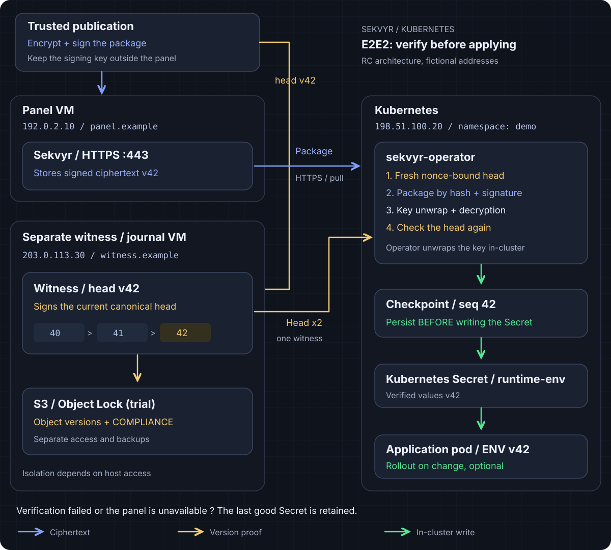
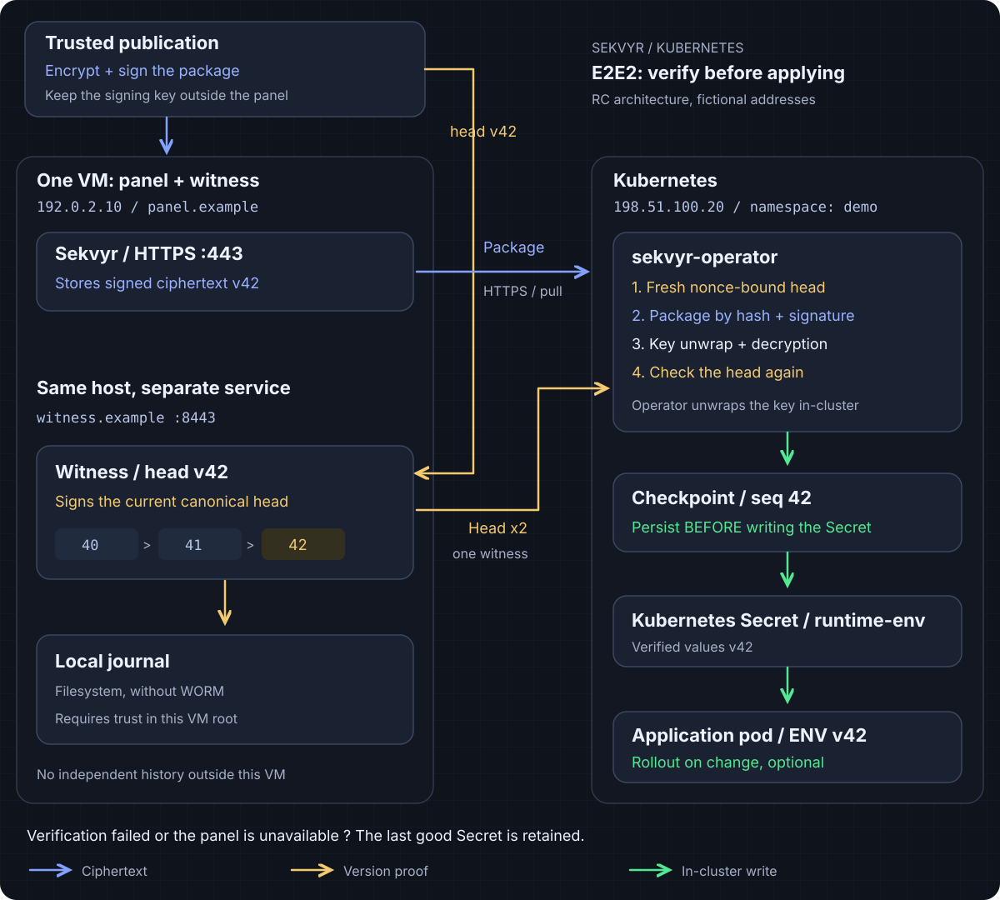

# Kubernetes E2E2 architecture

[Русская версия](kubernetes-architecture.ru.md) | [README](../README.md) | [Installation](../operator/docs/install.en.html) | [Operations and recovery](../operator/docs/operations.en.html)

This is the E2E2 publication and delivery path for panel `1.1.0-rc.1` and
operator/chart `0.1.0-rc.1`. These are release candidates. Stable panel `1.0.3`
does not provide this API, and agent `1.0.3` does not gain E2E2 support from it.
This architecture is not a production-ready HA or WORM guarantee.

The goal is to deliver an authorized, complete configuration to a Kubernetes
application while treating the panel as an untrusted ciphertext transport.
A signature alone proves who published a snapshot, not whether it is current.
An independently trusted witness supplies that second check.

## What each component does

| Component | Why it exists | Sensitive material |
| --- | --- | --- |
| Trusted publisher | Prepares a complete snapshot, encrypts it and signs its content and context. Publication is an explicit action. | Plaintext, AES read key and Ed25519 publisher signing key. Keep the signing client and key separate from the panel. |
| Panel | Stores staged encrypted envelopes and signed reader wraps, handles machine authentication and grants, and serves objects by hash. | Authentication material and ciphertext in this E2E2 path. It does not receive the plaintext read key or publisher private key. |
| Witness | Verifies a proposed publication and accepts it against the exact previous head. Signs fresh answers about the canonical head. | Its own signing key; no AES read key or publisher private key. |
| Witness journal | Preserves the accepted history independently of the panel's database. The canonical journal profile also records authority changes. | Signed records, retention receipts where used, and independent registration/checkpoint pins. |
| Kubernetes operator | Authenticates, verifies the exact current snapshot, unwraps its read key and decrypts inside the cluster. Then synchronizes selected values. | P256 node private key, wrapped/read keys, plaintext in memory, protected trust and state. |
| Kubernetes Secret | Gives the application the verified selected values through standard Kubernetes mechanisms. | Plaintext values. Base64 in Secret manifests is an encoding, not encryption. |
| Application | Reads the Secret through a volume or starts with values from `envFrom`/`secretKeyRef`. | The values it uses in memory and, for volumes, readable projected files. |

A **view** is the complete signed set available to a reader. Selecting a few
keys for the target Secret does not hide the remaining keys of that view from
the operator. Use separate views and grants to separate readers.

This is a separate publication path from ordinary panel secrets. An unsealed
panel can decrypt ordinary secrets using its server-side keys. E2E2 does not
retroactively make those secrets opaque to it. A compromised publisher client,
including the JavaScript it executes, can authorize malicious values: independent
signing keys and trusted delivery of the publishing client matter.

## From a change to the application

1. **An administrator establishes trust independently.** Provision the operator's
   node identity, exact panel/witness origins, public publisher/witness keys,
   scope and a positive minimum checkpoint. Bind them to this installation,
   Store/binding and exact Kubernetes object UIDs. Do not learn these pins from
   an incoming panel response. Lost state requires reviewed recovery, not an
   automatic fresh bootstrap.
2. **The publisher prepares the next complete snapshot.** It starts from the
   verified witness-canonical base, applies the intended edit, encrypts the full
   view and signs the envelope. It stages ciphertext in the panel and prepares
   a signed reader wrap that encrypts the AES read key for the operator's P256
   public key. Possessing a read key does not grant publication authority.
3. **The witness accepts a publication.** It checks the staged envelope, scope,
   signature and allowed authority, then conditionally appends against the exact
   previous head. A prepared file or panel index is not a canonical commit. The
   index helps discovery; it cannot select what the operator trusts as current.
4. **The operator asks the witness for a fresh head.** A new random nonce binds
   the signed answer to this request. The operator checks the independently
   pinned identity, scope and minimum/local checkpoint, then requests the
   envelope from the panel by that exact authenticated hash.
5. **The operator verifies and decrypts the whole view.** It checks the signature,
   context, hash and bounds, verifies the reader wrap for its node and decrypts.
   It then asks the **same witness again with a new nonce**. The two heads must
   match. If the head advanced, a bounded retry reads the newer snapshot. This
   is two freshness checks around decryption, not two witnesses or a quorum.
6. **Accepted authority is persisted before target data is written.** The
   operator saves its accepted checkpoint in protected state before updating
   the target Secret, with ownership, UID and resource-version checks. Identical
   selected plaintext creates no new data revision or rollout; checkpoint
   metadata can still advance. A previously authorized pending rollout is a
   separate transaction and may resume after successful revalidation.
7. **The application consumes the values.** A projected Secret volume can update
   asynchronously; the application must reread a consistent projection and
   avoid `subPath`. Environment variables of an already running process do not
   change. The operator's optional Deployment rollout starts new Pods only when
   separately enabled and authorized at installation, Store and SekvyrSecret
   levels. Rollout is disabled by default. Initial creation, equal plaintext or
   merely enabling rollout causes no historical restart.

Freshness means canonical at the last successful witness check. A new publication
can happen immediately afterwards. There is no atomic freshness guarantee across
the witness, Kubernetes objects and an application's reads.

## Two deployment boundaries

### Local deployment with a trusted host

For a lab or a deliberately trusted-host setup, the panel, witness process and
its filesystem journal can live on one VM. Process permissions and separate
volumes reduce accidental access, and the journal can detect inconsistent
history relative to retained independent checkpoints. A separate S3 service is
not a requirement for this development filesystem profile.

The host administrator can still replace processes, steal keys or roll back the
VM and its local state. A same-VM journal is not an independent rollback boundary
and is not WORM. The supplied filesystem witness advertises
`development-filesystem-not-worm` and `production_ready=false`. The HA trial uses
the separate canonical journal profile, not this filesystem profile.

### Independent witness and journal

To protect against a panel database rollback, give the witness and its durable
history a restore boundary independent of that database. Separate host/storage
administration, signing identities, access rights, independent checkpoint copies
and tested backups determine how independent that boundary actually is. Moving
another container to the same VM does not establish it.

The implemented trial S3 journal adapter requires bucket versioning and Object
Lock. It writes records conditionally and checks the exact stored versions for
`COMPLIANCE` mode and unexpired retention. This is an optional storage choice for
the architecture, not a service every installation must add. The adapter itself
requires those properties if selected; ordinary S3 storage is not equivalent.
Retention protects specific object versions for its configured period, not all
credentials, services or future writes. Keep separate permissions and backups,
and verify restore behavior and retention receipts. Self-hosted S3 compatibility
does not by itself provide AWS's infrastructure guarantees or protection from
the storage host's root administrator.

HA additionally needs the implemented canonical journal/gateway, fencer,
admission checks and signed enrollment/recovery. Adding replicas or Object Lock
alone does not enable safe HA. The supplied HA profile remains a trial, with one
log/view per installation; follow the installation and operations guides.

## Failures and limits

The E2E2 snapshot format allows at most 1024 entries, 8 MiB of canonical plaintext and
a 16 MiB envelope. Selected decoded values for one target Secret are separately
limited to 1 MiB. This is configuration delivery, not a general file store.

| Situation | Expected behavior or boundary |
| --- | --- |
| Panel or witness unavailable, panel sealed, authentication denied | No new snapshot is applied. The last good Secret and running application keep their issued values; current synchronization reports failure. E2E2 pending rollout also waits for successful source verification. |
| Panel returns old or modified bytes, or hides a committed snapshot | Hash/signature/context/freshness checks reject the response. If the exact canonical object is missing, synchronization fails instead of accepting an older one. |
| State, trust or target has been lost or replaced | The operator blocks the affected flow for reviewed recovery; deleting state is not a supported reset. |
| A value is revoked | Retaining the old Secret during failure preserves availability, not immediate revocation of already delivered data. Rotate/revoke at the consuming service too. |
| Publisher signing key or trusted client is compromised | An attacker can publish authorized-looking malicious values. Outside the guarantee. |
| Witness or its signing key is compromised | One witness can lie about freshness. Two calls to it are not Byzantine fault tolerance. Outside the guarantee. |
| Cluster/control-plane root, node identity or plaintext reader is compromised | Kubernetes readers can expose their values and keys. E2E2 does not protect plaintext inside a compromised trusted cluster. |
| All trusted history and independent checkpoints are rolled back together | Cryptography cannot reconstruct the missing evidence. |

Protect Kubernetes API and namespace access, workloads and backups. Configure
encryption at rest for etcd separately; E2E2 does not configure it. Keep Secret
values, private keys, JWTs and raw Secret exports out of logs, Git and Helm values.

Pod `Ready`, HTTP 200 and a successful Helm install prove neither current values
nor application consumption. Check fresh CR conditions, observed generations and
Store UID, the exact accepted checkpoint and a new successful synchronization,
then verify the application's actual read privately. The profile does not promise
production WORM, independent fault domains by default, exactly-once restarts or
safety against a compromised publisher, witness or cluster root.

## Implementation and next steps

- [Reader verification and double-head flow](../operator/internal/verification/reader.go)
- [Checkpoint and Secret synchronization](../operator/internal/syncer/sync.go)
- [Filesystem witness and its development limits](../operator/internal/witnessservice/README.html)
- [Trial S3 journal adapter](../operator/internal/journal/s3.go)
- [Installation, trust bootstrap and HA trial](../operator/docs/install.en.html)
- [Operations, rollout, backups and recovery](../operator/docs/operations.en.html)
- [Existing init/sidecar and External Secrets Operator paths](../deploy/kubernetes/README.md)

The older init/sidecar and ESO integrations have their own trust models. They do
not inherit this E2E2 witness protocol by using the same panel.
