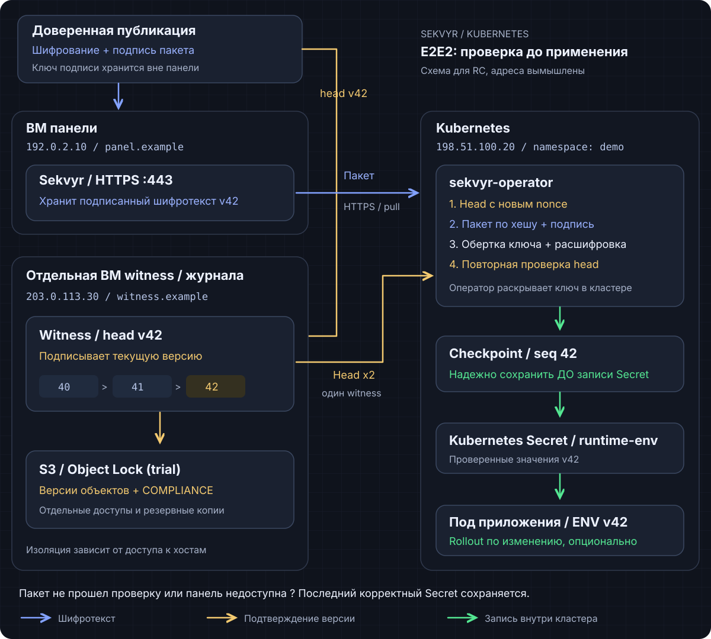
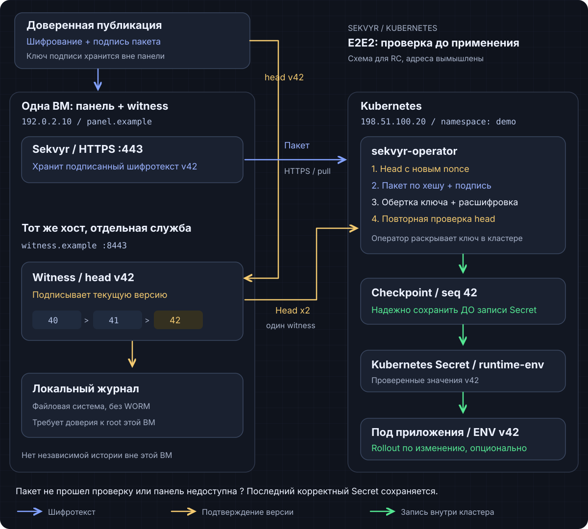

# Архитектура Kubernetes E2E2

[English version](kubernetes-architecture.md) | [README](../README.ru.md) | [Установка](../operator/docs/install.ru.html) | [Эксплуатация и восстановление](../operator/docs/operations.ru.html)

Здесь описан путь публикации и доставки E2E2 для панели `1.1.0-rc.1` и
оператора/chart `0.1.0-rc.1`. Это релиз-кандидаты. Стабильная панель `1.0.3`
не предоставляет этот API, агент `1.0.3` не получает от этого поддержку E2E2.
Эта архитектура не обещает готовые к production HA или WORM.

Задача - доставить приложению Kubernetes полный разрешенный набор настроек,
считая панель недоверенным транспортом шифротекста. Подпись подтверждает автора
снимка, но сама по себе не доказывает его актуальность. Для второй проверки нужен
независимо доверенный свидетель (witness).

## Зачем нужен каждый компонент

| Компонент | Назначение | Чувствительные данные |
| --- | --- | --- |
| Доверенный издатель (publisher) | Готовит полный снимок, шифрует его и подписывает содержимое вместе с контекстом. Публикация - явное действие. | Открытые значения, AES-ключ чтения и подписывающий ключ Ed25519. Клиент подписи и его ключ нужно держать отдельно от панели. |
| Панель | Хранит подготовленные шифрованные пакеты (envelope) и подписанные обертки ключей (reader wrap), проверяет машинный доступ и отдает объекты по хешу. | Данные аутентификации и шифротекст в этом пути E2E2. Незашифрованный AES-ключ чтения и приватный ключ publisher сюда не передаются. |
| Свидетель (witness) | Проверяет публикацию и принимает ее относительно точного предыдущего head. Подписывает свежие ответы о каноническом head. | Собственный ключ подписи; без AES-ключа чтения и приватного ключа publisher. |
| Журнал witness | Хранит принятую историю независимо от БД панели. Профиль canonical journal также фиксирует смену полномочий. | Подписанные записи, подтверждения retention при его использовании и независимо закрепленные регистрация/checkpoint. |
| Оператор Kubernetes | Аутентифицируется, проверяет точный актуальный снимок, раскрывает ключ чтения и расшифровывает внутри кластера. Затем синхронизирует выбранные значения. | Приватный ключ узла P256, обертки/ключи чтения, открытые значения в памяти, защищенные trust и state. |
| Kubernetes Secret | Передает приложению проверенные выбранные значения обычными средствами Kubernetes. | Открытые значения. Base64 в манифесте Secret - кодирование, не шифрование. |
| Приложение | Читает Secret из тома или запускается со значениями из `envFrom`/`secretKeyRef`. | Используемые значения в памяти и доступные файлы при подключении тома. |

**View** - полный подписанный набор, доступный читателю. Выбор нескольких ключей
для целевого Secret не скрывает остальные ключи этой view от оператора. Для
разделения читателей нужны отдельные view и разрешения.

Это отдельный путь публикации, отличающийся от обычных секретов панели.
Распечатанная (unsealed) панель может расшифровывать обычные секреты своими
серверными ключами. E2E2 не делает их задним числом недоступными панели.
Захваченный клиент издателя, включая исполняемый им JavaScript, может разрешить
вредоносные значения: важны отдельные ключи подписи и доверенная доставка клиента
публикации.

## От изменения до приложения

1. **Администратор независимо задает доверие.** Подготавливает идентичность узла
   оператора, точные origin панели/witness, открытые ключи publisher/witness,
   scope и положительный minimum checkpoint. Привязывает их к установке,
   Store/binding и точным UID объектов Kubernetes. Эти pins нельзя получать из
   входящего ответа панели. Потеря state требует проверенного восстановления,
   а не автоматического bootstrap с нуля.
2. **Publisher готовит следующий полный снимок.** Берет проверенную каноническую
   базу witness, вносит нужное изменение, шифрует всю view и подписывает пакет.
   Размещает подготовленный шифротекст в панели и создает подписанную обертку,
   шифрующую AES-ключ чтения для открытого P256-ключа оператора. Владение ключом
   чтения не дает права публикации.
3. **Witness принимает публикацию.** Проверяет подготовленный пакет, scope,
   подпись и разрешенные полномочия, затем условно добавляет запись относительно
   точного предыдущего head. Подготовленный файл или индекс панели не равны
   каноническому commit. Индекс помогает найти публикацию, но не определяет,
   что оператор считает актуальным.
4. **Оператор запрашивает свежий head у witness.** Новый случайный nonce
   привязывает подписанный ответ к конкретному запросу. Оператор проверяет
   независимо закрепленную идентичность, scope и minimum/local checkpoint,
   затем запрашивает у панели пакет по этому точному подтвержденному хешу.
5. **Оператор проверяет и расшифровывает всю view.** Проверяет подпись, контекст,
   хеш и лимиты, проверяет обертку для своего узла и расшифровывает. Затем
   обращается к **тому же witness еще раз с новым nonce**. Оба head должны
   совпасть. Если head продвинулся, ограниченный повтор читает новый снимок.
   Это две проверки свежести вокруг расшифрования, а не два witness или кворум.
6. **Принятый checkpoint сохраняется до записи целевых данных.** Оператор
   сохраняет checkpoint в защищенном state перед обновлением Secret, проверяя
   владельца, UID и resourceVersion. Одинаковые выбранные открытые значения не
   создают новую ревизию данных или rollout; метаданные checkpoint могут
   обновиться. Ранее разрешенный ожидающий rollout - отдельная транзакция,
   которая может продолжиться после успешной повторной проверки.
7. **Приложение получает значения.** Проекция Secret в том обновляется
   асинхронно; приложение должно перечитывать согласованную проекцию без
   `subPath`. Переменные окружения уже работающего процесса не меняются.
   Необязательный rollout Deployment запускает новые Pod только после отдельного
   включения и разрешения на уровнях установки, Store и SekvyrSecret. По
   умолчанию rollout выключен. Первое создание, одинаковые открытые значения или
   само включение rollout не вызывают перезапуск задним числом.

Свежесть означает каноническое состояние на момент последней успешной проверки
witness. Новая публикация возможна сразу после нее. Атомарная актуальность между
witness, объектами Kubernetes и чтением приложения не гарантируется.

## Два варианта границ доверия

### Локальная установка с доверенным хостом

Для стенда или сознательно выбранного доверенного хоста панель, процесс witness
и его файловый журнал могут жить в одной ВМ. Права процессов и отдельные тома
снижают риск случайного доступа, журнал позволяет выявлять несовместимую историю
относительно сохраненных независимых checkpoints. Отдельный S3-сервис для этого
development filesystem profile не обязателен.

Администратор хоста все еще может заменить процессы, украсть ключи или откатить
ВМ с локальным state. Журнал в той же ВМ не создает независимую границу отката и
не дает WORM. Поставляемый файловый witness объявляет
`development-filesystem-not-worm` и `production_ready=false`. HA trial использует
отдельный профиль canonical journal, а не этот файловый профиль.

### Независимые witness и журнал

Для защиты от отката БД панели witness и его долговечная история должны иметь
независимую от этой БД границу восстановления. Раздельное управление хостами и
хранилищем, ключи подписи, права доступа, независимые копии checkpoint и
проверенные бэкапы определяют, насколько эта граница независима. Еще один
контейнер в той же ВМ этого не обеспечивает.

Реализованный trial S3 adapter журнала требует versioning бакета и Object Lock.
Он условно записывает записи и проверяет точные сохраненные версии объектов на
режим `COMPLIANCE` и неистекший retention. Для архитектуры это необязательный
вариант хранения, а не сервис, который нужно добавлять в каждую установку.
Если выбран этот адаптер, эти свойства обязательны; обычное S3-хранилище их не
заменяет. Retention защищает конкретные версии объектов в течение заданного
срока, а не все учетные данные, сервисы и будущие записи. Нужны раздельные права
и бэкапы, проверка восстановления и подтверждений retention. Совместимость
self-hosted S3 сама по себе не дает инфраструктурных гарантий AWS или защиты
от root администратора хоста хранения.

Для HA дополнительно нужны реализованные canonical journal/gateway, fencer,
admission-проверки и подписанные enrollment/recovery. Одних реплик или Object Lock
недостаточно для безопасного HA. Поставляемый профиль HA остается trial, с одним
log/view на установку; порядок настройки описан в руководствах.

## Сбои и ограничения

Снимок E2E2 допускает до 1024 записей, 8 MiB канонического открытого текста и
16 MiB на пакет. Выбранные декодированные значения одного целевого Secret
отдельно ограничены 1 MiB. Это доставка конфигурации, а не хранилище файлов.

| Ситуация | Поведение или граница гарантии |
| --- | --- |
| Панель или witness недоступны, панель запечатана, доступ отклонен | Новый снимок не применяется. Последний рабочий Secret и приложение сохраняют уже выданные значения; текущая синхронизация сообщает об ошибке. Ожидающий E2E2 rollout также ждет успешной проверки источника. |
| Панель отдает старые/измененные данные или скрывает принятую публикацию | Проверки хеша, подписи, контекста и свежести отклоняют ответ. Если точный канонический объект отсутствует, синхронизация завершается ошибкой вместо принятия старого. |
| State, trust или целевой объект потерян либо заменен | Оператор блокирует затронутый путь до проверенного восстановления; удаление state не служит сбросом. |
| Значение отозвано | Сохранение старого Secret при сбое поддерживает доступность, но не отзывает уже доставленные данные немедленно. Нужен отзыв/ротация и на стороне сервиса-потребителя. |
| Захвачен ключ подписи или доверенный клиент publisher | Злоумышленник может опубликовать вредоносные значения с допустимой подписью. За пределами гарантии. |
| Захвачен witness или его ключ подписи | Один witness может солгать о свежести. Два обращения к нему не дают устойчивость к Byzantine-сбоям. За пределами гарантии. |
| Захвачен root кластера/control plane, идентичность узла или читатель открытых значений | Читатели Kubernetes могут раскрыть свои значения и ключи. E2E2 не защищает открытые данные внутри захваченного доверенного кластера. |
| Выполнен общий откат доверенной истории и независимых checkpoints | Криптография не восстановит утраченное доказательство. |

Защитите Kubernetes API, namespace, workloads и бэкапы. Шифрование etcd at rest
настраивается отдельно; E2E2 его не включает. Не помещайте значения Secret,
приватные ключи, JWT и сырые экспорты Secret в логи, Git или Helm values.

Pod `Ready`, HTTP 200 и успешная установка Helm не подтверждают ни актуальные
значения, ни чтение приложением. Нужны свежие CR conditions, observed generations
и UID Store, точный принятый checkpoint и новая успешная синхронизация, затем
приватная проверка реального чтения приложением. Профиль не обещает production
WORM, независимые fault domains по умолчанию, перезапуск строго один раз или
безопасность при захвате publisher, witness либо root кластера.

## Реализация и дальнейшие шаги

- [Проверка снимка и два запроса head](../operator/internal/verification/reader.go)
- [Checkpoint и синхронизация Secret](../operator/internal/syncer/sync.go)
- [Файловый witness и ограничения development-профиля](../operator/internal/witnessservice/README.html)
- [Trial S3 adapter журнала](../operator/internal/journal/s3.go)
- [Установка, bootstrap доверия и HA trial](../operator/docs/install.ru.html)
- [Эксплуатация, rollout, бэкапы и восстановление](../operator/docs/operations.ru.html)
- [Существующие init/sidecar и External Secrets Operator](../deploy/kubernetes/README.ru.md)

У прежних интеграций init/sidecar и ESO свои модели доверия. Использование той же
панели не добавляет им этот протокол witness E2E2.
